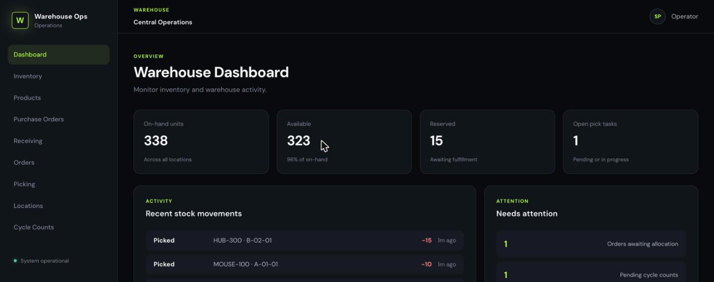
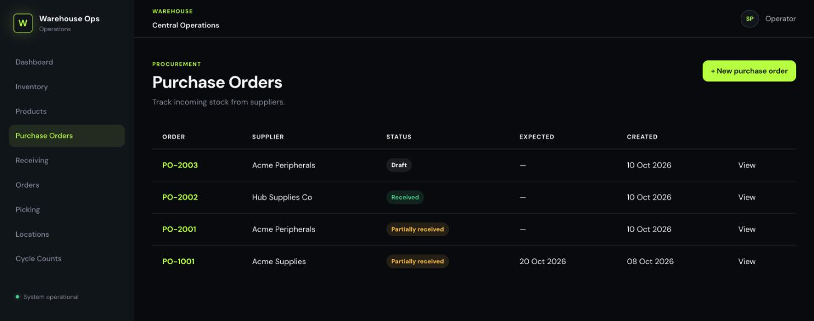
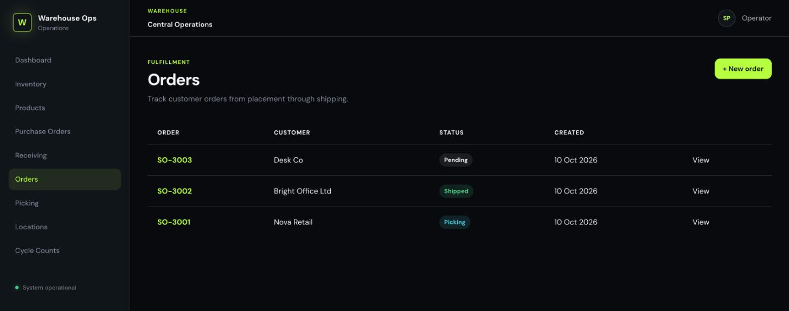
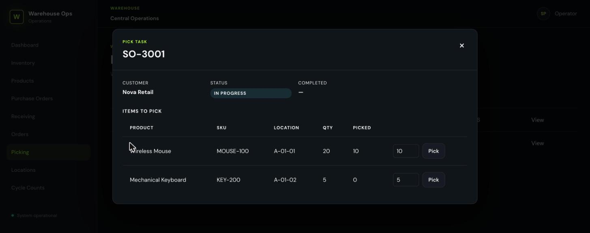
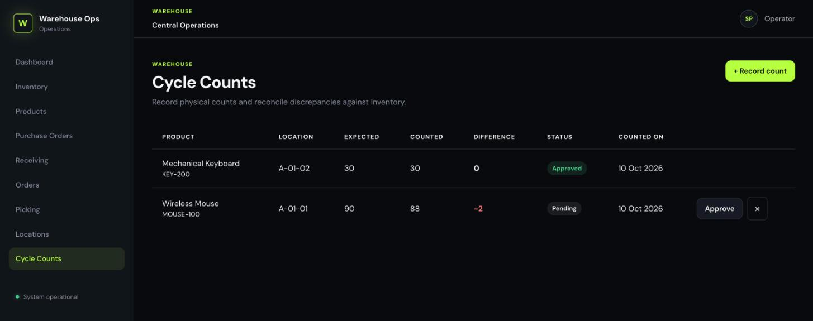

# Warehouse Ops

A warehouse management system covering the full flow of goods through a warehouse:

```
Purchase Order → Receiving → Storage → Inventory → Picking → Packing → Shipping
```

Also included: cycle counting, to reconcile physical counts against recorded inventory.

See [`docs/domain-model.md`](docs/domain-model.md) for the full domain model and invariants.

## Screenshots

**Dashboard** — live on-hand/available/reserved totals, open pick tasks, recent stock movements, and what needs attention.



**Purchase Orders** — track incoming stock from suppliers through draft, ordered, and (partially) received.



**Orders** — customer orders moving through allocation, picking, packing, and shipping.



**Picking** — work an open pick task location by location, with quantities validated against what's allocated.



**Cycle Counts** — record a physical count, see the discrepancy, approve it to post an inventory adjustment (or reject it).



## Tech stack

- **API** (`apps/api`) — Fastify, Drizzle ORM, PostgreSQL, Zod, TypeScript, Vitest
- **Web** (`apps/web`) — React, Vite, React Router, TypeScript
- Modular monolith: each domain (products, warehouses, inventory, purchase-orders, sales-orders, picking, cycle-counts) is a self-contained module with its own schema, repository, service, and routes

## Getting started

### Prerequisites

- Node.js 20+
- A local PostgreSQL instance, with two databases: one for development, one for running integration tests

### Install

```bash
npm install
```

### Configure

Create `apps/api/.env`:

```
DATABASE_URL=postgresql://<user>@localhost:5432/warehouse_ops
```

### Run migrations

```bash
npm run db:migrate -w apps/api
```

### Start the dev servers

```bash
npm run dev:api   # Fastify API on http://localhost:3001
npm run dev:web   # Vite dev server on http://localhost:5173
```

## Testing

```bash
npm run test -w apps/api               # unit tests
npm run test:integration -w apps/api   # integration tests (needs a *_test database; see apps/api/scripts/run-integration-tests.mjs)
npm run lint -w apps/web
```

## Inventory Overview

The **Inventory Overview** page (`/inventory/overview`) shows stock per product and location with server-side filtering, sorting and pagination, plus three charts.

| Endpoint | Purpose |
| --- | --- |
| `GET /api/inventory/overview` | One page of inventory rows: on hand, available, stock status, last movement date. Query: `locationId`, `status` (`IN_STOCK`, `LOW_STOCK`, `OUT_OF_STOCK`), `search`, `sortBy`, `sortDir`, `page`, `pageSize` (max 100). Validated with Zod. |
| `GET /api/inventory/summary` | Chart data: stock by location (top 20), movements per day for the last 30 UTC days (zero-filled), top 10 items by units moved. |
| `PUT /api/inventory/:id/cycle-count-flag` | Body `{ "flagged": boolean }`. Marks a row for recount. Idempotent; never changes stock or writes a stock movement. |

Stock status: `OUT_OF_STOCK` when available ≤ 0, `LOW_STOCK` when 1–10 available, otherwise `IN_STOCK`. The threshold of 10 is a single constant (`LOW_STOCK_THRESHOLD`); there is no per-product reorder point yet.

## Performance notes

Everything below was measured, not estimated. Raw outputs came from `npm run bench:api` and `EXPLAIN (ANALYZE, BUFFERS)`.

**Setup.** Local PostgreSQL 14.17 (CI and production use 16) on an Apple M1 with 16 GB RAM. Dataset from `npm run db:seed:bulk` into a throwaway `*_perf` database: 5,000 products, 40 locations, 150,000 inventory rows, 1,350,216 stock movements spread over 90 days (`stock_movements` is 130 MB). Timings are warm-cache, 20 runs per scenario after one warm-up, over real HTTP on loopback, page size 25. The database had a 60 s `statement_timeout`, so "timeout" means the request was still running at 60 s.

### API response times (median ms, p95 in brackets)

| Scenario | Before indexes | After indexes |
| --- | --- | --- |
| Overview, default sort, page 1 | 1642 (1710) | 57 (136) |
| Overview, page 2000 (deep offset) | timeout (> 60 000) | 180 (303) |
| Overview, location + sort by available | 1290 (1298) | 13 (21) |
| Overview, `status=LOW_STOCK` | 1305 (1366) | 15 (17) |
| Overview, search "steel widget" | 1478 (1567) | 56 (69) |
| Overview, sort by last movement | timeout (> 60 000) | 388 (432) |
| Overview, location + status + search | 1641 (1682) | 9 (10) |
| Summary | 504 (540) | 129 (146) |

The "after" p95 for the default scenario has a noisy tail (max 238 ms); I did not isolate the cause.

### Indexes and EXPLAIN ANALYZE

Two indexes were added to `stock_movements` (migration `0006`):

- `(product_id, location_id, created_at)`: "newest movement for this product at this location".
- `(created_at)`: range scans over the last 30 days for the summary.

**Before.** The overview computes "last movement" with a lateral subquery, run once per row on the page. With only the primary key, each of the 25 lookups scanned the whole table:

```
->  Aggregate  (actual time=53.669..53.669 rows=1 loops=25)
      ->  Seq Scan on stock_movements m  (actual time=2.044..53.662 rows=9 loops=25)
            Filter: ((product_id = i.product_id) AND (location_id = i.location_id))
            Rows Removed by Filter: 1350207
Execution Time: 1440.444 ms
```

**After.** The same lookup is an index-only scan with no table access:

```
->  Index Only Scan Backward using stock_movements_product_location_created_idx on stock_movements m
      (actual time=0.006..0.006 rows=1 loops=25)
      Heap Fetches: 0
Execution Time: 100.454 ms   (this single run; the median over 20 runs was 57 ms)
```

The remaining time is sorting 150,000 joined rows by product name (an external merge sort, about 6 MB spilled to disk per worker).

The page-2000 and sort-by-last-movement requests need the lookup for far more rows (about 50,000 and all 150,000), which is why they timed out before. Sorting by last movement is still the slowest case (388 ms) because it needs one index probe per inventory row. Making it faster would need a `last_movement_at` column kept up to date on every stock movement write. I deliberately did not do that: it would change how movements are written.

**Summary queries.** Movements per day went from a sequential scan of the table (440 ms scan, 492 ms query) to a bitmap index scan on `created_at` (148 ms query); top 10 items from 166 ms to 91 ms. In this dataset the 30-day window is still 32% of the table, because history is only 90 days deep. With longer history the index helps more.

**What the indexes cost.**

- Size: 76 MB and 29 MB, on a 130 MB table.
- Writes: inserting 100,000 movements took about 1.2–1.5 s with the indexes (a cold first run took 2.8 s) against about 0.9–1.1 s without, in three rolled-back trials. That is roughly 3 µs more per row, which is negligible for single-row writes but not free for bulk loads.
- Creating them took about 3 s on 1.35M rows. On a busy production table, `CREATE INDEX` blocks writes; use `CREATE INDEX CONCURRENTLY` outside a migration transaction.

**Tried and rejected.**

- `inventory(location_id)`: location-filtered queries took 7.3 ms with it and 11.8 ms without. A few milliseconds at 150k rows is not worth an index every inventory write must maintain.
- A covering `created_at INCLUDE (product_id, quantity)`: summary 137 ms to 100 ms. Drizzle cannot express `INCLUDE`, so the schema file would drift from the database.

### Frontend behaviour

Measured against the production build (`vite build`, served with `vite preview`) pointed at the API on the large dataset, in Chrome, driven from the page with the Long Tasks and Layout Instability APIs. Page size is 10. I did not use the React DevTools Profiler, which needs a GUI.

| Measure | Result |
| --- | --- |
| Requests per page change, filter change or sort change | 1 |
| Requests while typing 5 characters in search | 1 (debounced 300 ms) |
| Requests when revisiting a page or filter within `staleTime` | 0 (rendered from cache) |
| Layout shift during paging, sorting and filtering | CLS 0 |
| Layout shift on initial load | 0.002, from the web font loading (not the table) |
| Table height after paging, filtering, search | 565 px, 564 px (reserved full-page height) |
| Lighthouse (mobile emulation, throttled), 3 runs | Performance 82 / 90 / 90, Accessibility 100 |
| Lighthouse TBT / CLS | 60–80 ms / 0.002 |
| Lighthouse LCP / FCP | 3.0–3.8 s / 2.6–3.2 s |

Lighthouse 12.8.2 was run through `npx` and is not a project dependency. Its LCP and FCP are slow mainly because of the simulated slow network and an 858 kB (250 kB gzipped) JavaScript bundle, most of it recharts. The bundle is not code-split yet.

**A problem found and fixed by measuring.** Every page change was causing a long task of about 55 ms, because the memo-less charts re-rendered each time: 78 DOM mutations inside the charts per page change. After wrapping `InventoryCharts` in `memo` and giving it a stable `onRetry`: 0 chart mutations over 8 page changes, no long tasks, and UI time beyond the API call dropped from about 55 ms to about 15 ms. (API latency itself varied between the two sessions, 48–52 ms and 101–117 ms, so compare the overhead, not the totals.)

### Caching approach

- Each combination of filters, sort and page is its own cache entry (`["inventory", "overview", params]`).
- `staleTime` is 30 s for the overview and 60 s for the summary. While fresh, revisiting a page costs no request.
- Once stale, cached data is shown immediately and refetched in the background (also when the tab regains focus).
- While the next page or filter loads, the previous rows stay on screen, dimmed (`keepPreviousData`), so the table never blanks.
- Flagging a row updates the cache at once, rolls back only that row if the request fails, and refetches the overview when the last in-flight flag settles. Receiving stock elsewhere invalidates `["inventory"]`, which also covers these queries.
- **Tradeoff:** for up to 30 s (60 s for charts) another user's change may not appear, and a refetch on focus can swap in different rows. That is acceptable for a monitoring view; for an action that needs exact numbers (allocating or picking), do not read from this cache.
